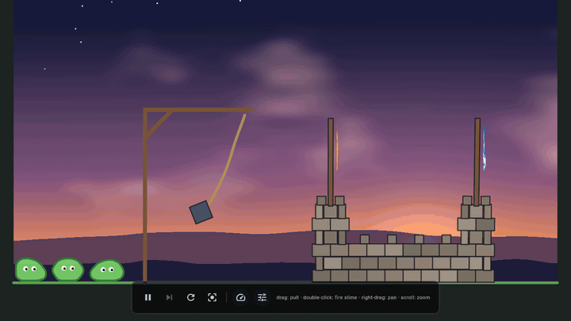

# xpbd_viz

A 2D XPBD (extended position-based dynamics) physics sandbox. The solver is
written in Rust, the UI and rendering in Flutter, joined by
[flutter_rust_bridge](https://github.com/fzyzcjy/flutter_rust_bridge). Runs on
Linux, Windows and the web (Rust compiled to WebAssembly).



[Live demo](https://sorpirit.github.io/xpbd_vis_flutter_rs/)

## What's in it

- **Solver:** particles with distance, area and shape-matching constraints,
  particle collisions on a uniform grid, friction, fixed 60 Hz steps with
  substeps.
- **Scene:** a stone castle, flags on rigid poles, a battering ram on a rope,
  and soft slimes.
- **Rendering:** a GLSL fragment-shader sky, themed bodies, and debug gizmos
  for particles, constraints, velocities, contacts and the collision grid.
- **Threading:** physics runs off the UI thread; drawing interpolates between
  physics states, so it stays smooth at any refresh rate.

## Controls

| Input | Action |
|---|---|
| Drag | Pull a particle |
| Double-click | Fire a slime at that point |
| Right-drag or middle-drag | Pan |
| Scroll | Zoom |

## Run

Needs Flutter, Rust, and `cargo install flutter_rust_bridge_codegen`.

```bash
flutter run -d linux --release
```

For the web, build the WebAssembly first, then serve with cross-origin
isolation headers:

```bash
flutter_rust_bridge_codegen build-web --release
flutter run -d chrome --release \
  --web-header=Cross-Origin-Opener-Policy=same-origin \
  --web-header=Cross-Origin-Embedder-Policy=require-corp
```

After changing the Rust API, regenerate the bindings:

```bash
flutter_rust_bridge_codegen generate
```

## Layout

| Path | Contents |
|---|---|
| `rust/src/api/sim.rs` | The solver and the scene |
| `lib/scene_page.dart` | Page, input, panels |
| `lib/scene_painter.dart` | Scene, sky and gizmo painters |
| `shaders/sky.frag` | Sky shader |

Solver tests: `cd rust && cargo test --release`.
